# Character Perspective Skills

Character role-play skills, indexed by work and character.

- **444** character directories · **47** works
- Portrait identity and provenance: [source manifest](assets/portrait_sources.json)
- Maintenance and verification: [portrait guide](assets/portraits/README.md)

<!-- Generated by scripts/portraits.py render; edit the source manifest, not this index. -->

## 天色＊アイルノーツ / Amairo Islenauts (`amairo-islenauts`)

<table>
<tr>
<td align="center"><a href="characters/amairo-islenauts/airi-perspective/">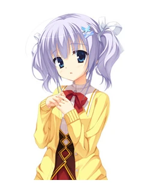 白鹿愛莉</a></td>
<td align="center"><a href="characters/amairo-islenauts/hinomiya-konoka-perspective/">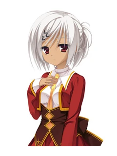 火宮木乃香</a></td>
<td align="center"><a href="characters/amairo-islenauts/masaki-perspective/">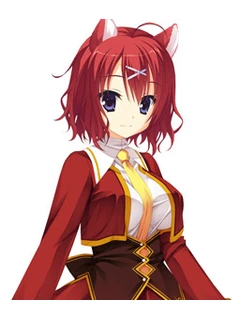 真咲・ガイヤール</a></td>
<td align="center"><a href="characters/amairo-islenauts/shirley-perspective/">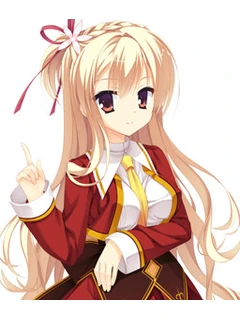 シャーリィ</a></td>
<td align="center"><a href="characters/amairo-islenauts/tia-hohenwerfen-perspective/">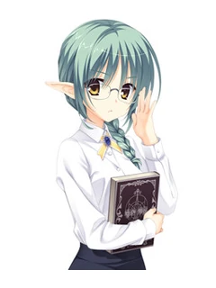 ティア・ホーエンヴェルフェン</a></td>
<td align="center"><a href="characters/amairo-islenauts/yune-perspective/">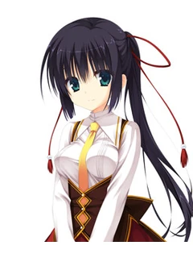 天霧夕音</a></td>
</tr>
</table>

## Angel Beats! (`angel-beats`)

<table>
<tr>
<td align="center"><a href="characters/angel-beats/tachibana-kanade-perspective/">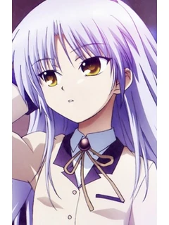 立华奏</a></td>
</tr>
</table>

## BanG Dream! Ave Mujica (`ave-mujica`)

<table>
<tr>
<td align="center"><a href="characters/ave-mujica/misumi-uika-perspective/">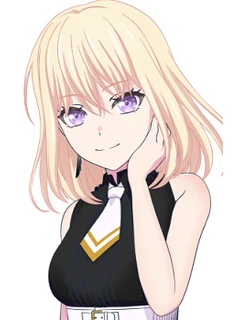 三角初华</a></td>
<td align="center"><a href="characters/ave-mujica/togawa-sakiko-perspective/">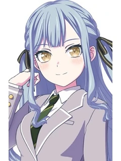 丰川祥子</a></td>
<td align="center"><a href="characters/ave-mujica/wakaba-mutsumi-perspective/">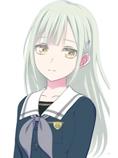 若叶睦</a></td>
<td align="center"><a href="characters/ave-mujica/yahata-umiri-perspective/">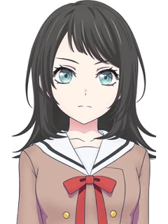 八幡海铃</a></td>
<td align="center"><a href="characters/ave-mujica/yutenji-nyamu-perspective/"> 祐天寺喵梦</a></td>
</tr>
</table>

## 孤独摇滚！ (`bocchi-the-rock`)

<table>
<tr>
<td align="center"><a href="characters/bocchi-the-rock/hitori-gotoh-perspective/">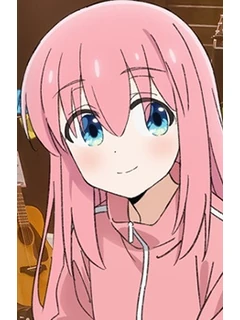 后藤一里</a></td>
<td align="center"><a href="characters/bocchi-the-rock/ikuyo-kita-perspective/">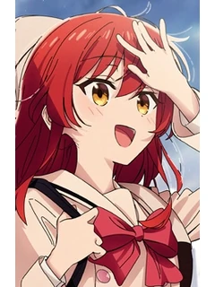 喜多郁代</a></td>
<td align="center"><a href="characters/bocchi-the-rock/kikuri-hiroi-perspective/">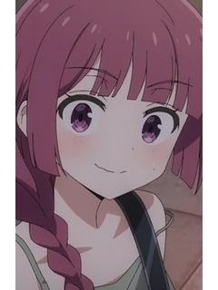 广井菊里</a></td>
<td align="center"><a href="characters/bocchi-the-rock/nijika-ijichi-perspective/">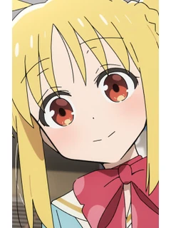 伊地知虹夏</a></td>
<td align="center"><a href="characters/bocchi-the-rock/pa-san-perspective/">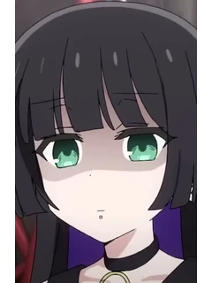 PA小姐</a></td>
<td align="center"><a href="characters/bocchi-the-rock/ryo-yamada-perspective/">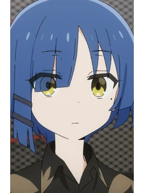 山田凉</a></td>
</tr>
<tr>
<td align="center"><a href="characters/bocchi-the-rock/seika-ijichi-perspective/">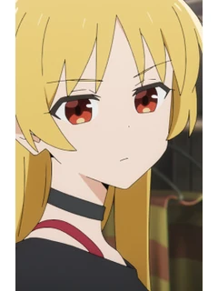 伊地知星歌</a></td>
</tr>
</table>

## 星光咖啡馆与死神之蝶 / 喫茶ステラと死神の蝶 / Café Stella and the Reaper's Butterflies (`cafe-stella`)

<table>
<tr>
<td align="center"><a href="characters/cafe-stella/akatsuki-kanna-perspective/">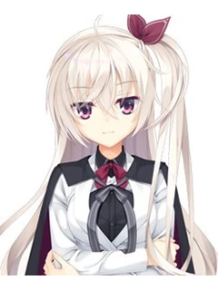 明月栞那</a></td>
<td align="center"><a href="characters/cafe-stella/hiuchidani-ai-perspective/">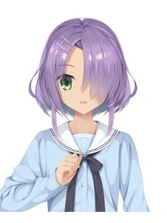 火打谷愛衣</a></td>
<td align="center"><a href="characters/cafe-stella/shiki-natsume-perspective/">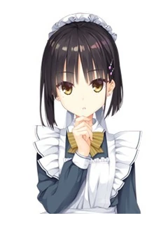 四季ナツメ</a></td>
<td align="center"><a href="characters/cafe-stella/shioyama-suzune-perspective/">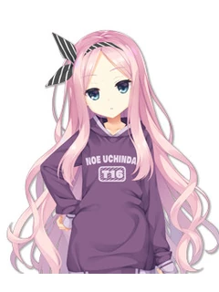 汐山涼音</a></td>
<td align="center"><a href="characters/cafe-stella/sumizome-nozomi-perspective/">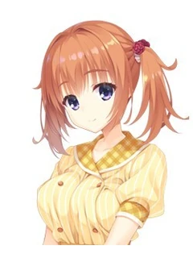 墨染希</a></td>
</tr>
</table>

## Charlotte (`charlotte`)

<table>
<tr>
<td align="center"><a href="characters/charlotte/tomori-nao-perspective/">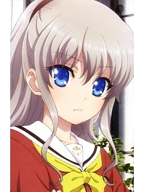 友利奈绪</a></td>
</tr>
</table>

## 弹丸论破 / Danganronpa (`danganronpa`)

<table>
<tr>
<td align="center"><a href="characters/danganronpa/kyoko-kirigiri-perspective/">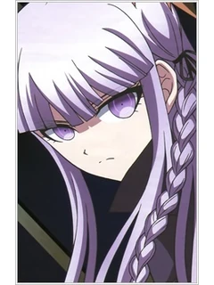 雾切响子</a></td>
</tr>
</table>

## 德古拉之怒 (`dracu-riot`)

<table>
<tr>
<td align="center"><a href="characters/dracu-riot/azusa-perspective/">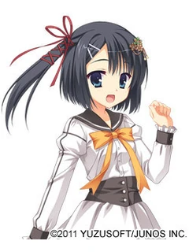 布良梓</a></td>
<td align="center"><a href="characters/dracu-riot/elina-perspective/">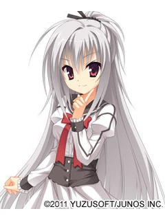 エリナ</a></td>
<td align="center"><a href="characters/dracu-riot/miu-perspective/">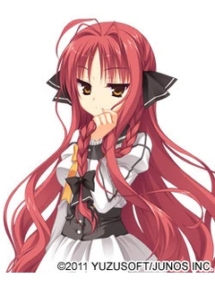 矢来美羽</a></td>
<td align="center"><a href="characters/dracu-riot/nicola-cepheus-perspective/">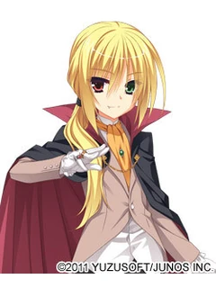 ニコラ</a></td>
<td align="center"><a href="characters/dracu-riot/rio-perspective/">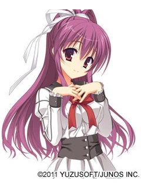 稲叢莉音</a></td>
</tr>
</table>

## 契约之吻 / Engage Kiss (`engage-kiss`)

<table>
<tr>
<td align="center"><a href="characters/engage-kiss/kisaragi-perspective/">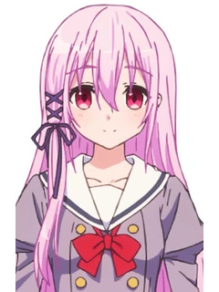 木更</a></td>
<td align="center"><a href="characters/engage-kiss/ogata-shu-perspective/">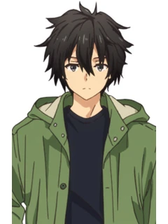 绪方修</a></td>
<td align="center"><a href="characters/engage-kiss/sharon-holygrail-perspective/">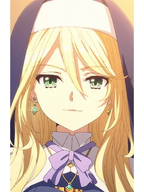 莎朗·霍莉格雷尔</a></td>
<td align="center"><a href="characters/engage-kiss/yugiri-ayano-perspective/"> 夕桐绫乃</a></td>
</tr>
</table>

## FGO (`fate-grand-order`)

<table>
<tr>
<td align="center"><a href="characters/fate-grand-order/mash-kyrielight-perspective/">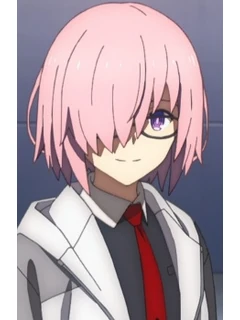 玛修</a></td>
</tr>
</table>

## FS/N (`fate-stay-night`)

<table>
<tr>
<td align="center"><a href="characters/fate-stay-night/emiya-shirou-perspective/">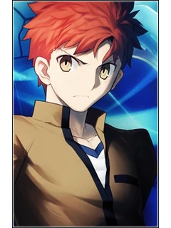 卫宫士郎</a></td>
<td align="center"><a href="characters/fate-stay-night/illyasviel-von-einzbern-perspective/">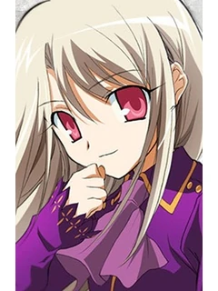 伊莉雅</a></td>
<td align="center"><a href="characters/fate-stay-night/kotomine-kirei-perspective/">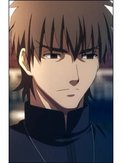 言峰绮礼</a></td>
<td align="center"><a href="characters/fate-stay-night/rin-tohsaka-perspective/">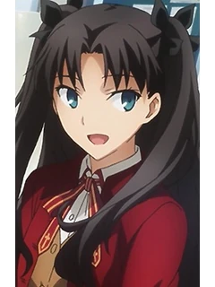 远坂凛</a></td>
<td align="center"><a href="characters/fate-stay-night/sakura-matou-perspective/">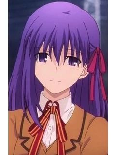 间桐樱</a></td>
</tr>
</table>

## FATE (`fate`)

<table>
<tr>
<td align="center"><a href="characters/fate/artoria-pendragon-perspective/">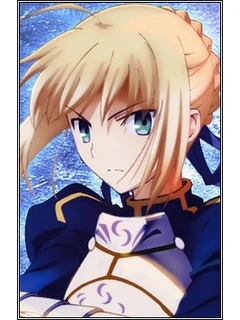 阿尔托利亚</a></td>
</tr>
</table>

## 偶像大师（含765Pro、灰姑娘女孩/U149、Million Live!、Shiny Colors、Dearly Stars、学園アイドルマスター） (`idolmaster`)

<table>
<tr>
<td align="center"><a href="characters/idolmaster/abe-nana-perspective/"> 安部菜々</a></td>
<td align="center"><a href="characters/idolmaster/akagi-miria-perspective/">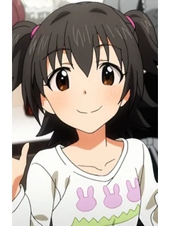 赤城みりあ</a></td>
<td align="center"><a href="characters/idolmaster/aketa-mikoto-perspective/">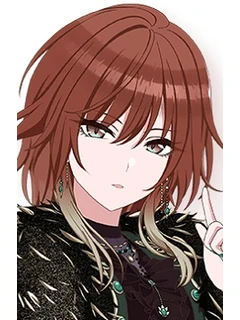 緋田美琴</a></td>
<td align="center"><a href="characters/idolmaster/akizuki-ritsuko-perspective/">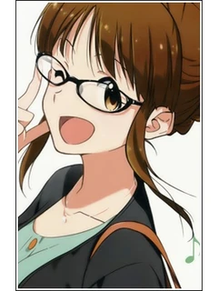 秋月律子</a></td>
<td align="center"><a href="characters/idolmaster/akizuki-ryo-perspective/">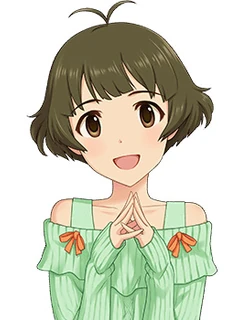 秋月涼</a></td>
<td align="center"><a href="characters/idolmaster/amami-haruka-perspective/">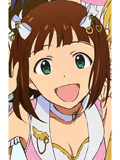 天海春香</a></td>
</tr>
<tr>
<td align="center"><a href="characters/idolmaster/arima-rinse-perspective/">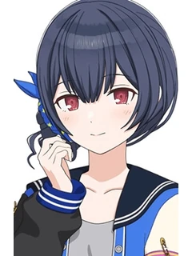 杜野凛世</a></td>
<td align="center"><a href="characters/idolmaster/asakura-toru-perspective/">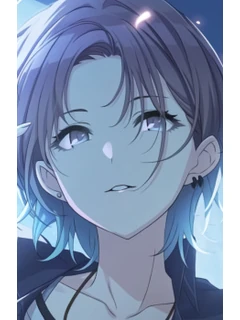 浅倉透</a></td>
<td align="center"><a href="characters/idolmaster/baba-konomi-perspective/">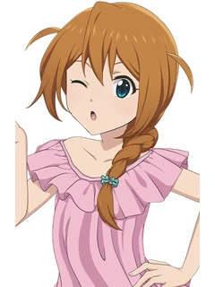 馬場このみ</a></td>
<td align="center"><a href="characters/idolmaster/emily-stewart-perspective/"> エミリースチュアート</a></td>
<td align="center"><a href="characters/idolmaster/fukuda-noriko-perspective/">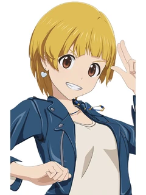 福田のり子</a></td>
<td align="center"><a href="characters/idolmaster/fukumaru-koito-perspective/">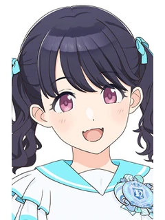 福丸小糸</a></td>
</tr>
<tr>
<td align="center"><a href="characters/idolmaster/futami-ami-perspective/"> 双海亜美</a></td>
<td align="center"><a href="characters/idolmaster/futami-mami-perspective/"> 双海真美</a></td>
<td align="center"><a href="characters/idolmaster/ganaha-hibiki-perspective/"> 我那覇響</a></td>
<td align="center"><a href="characters/idolmaster/hakozaki-serika-perspective/"> 箱崎星梨花</a></td>
<td align="center"><a href="characters/idolmaster/hidaka-ai-perspective/"> 日高愛</a></td>
<td align="center"><a href="characters/idolmaster/higuchi-enoka-perspective/"> 樋口円香</a></td>
</tr>
<tr>
<td align="center"><a href="characters/idolmaster/hojo-karen-perspective/"> 北条加蓮</a></td>
<td align="center"><a href="characters/idolmaster/honda-mio-perspective/"> 本田未央</a></td>
<td align="center"><a href="characters/idolmaster/hoshii-miki-perspective/"> 星井美希</a></td>
<td align="center"><a href="characters/idolmaster/ibuki-tsubasa-perspective/"> 伊吹翼</a></td>
<td align="center"><a href="characters/idolmaster/ichihara-nina-perspective/"> 市原仁奈</a></td>
<td align="center"><a href="characters/idolmaster/ichinose-shiki-perspective/"> 一ノ瀬志希</a></td>
</tr>
<tr>
<td align="center"><a href="characters/idolmaster/izumi-mei-perspective/"> 和泉愛依</a></td>
<td align="center"><a href="characters/idolmaster/julia-perspective/"> ジュリア</a></td>
<td align="center"><a href="characters/idolmaster/kanzaki-ranko-perspective/"> 神崎蘭子</a></td>
<td align="center"><a href="characters/idolmaster/kasuga-mirai-perspective/"> 春日未来</a></td>
<td align="center"><a href="characters/idolmaster/kikuchi-makoto-perspective/"> 菊地真</a></td>
<td align="center"><a href="characters/idolmaster/kinoshita-hinata-perspective/"> 木下ひなた</a></td>
</tr>
<tr>
<td align="center"><a href="characters/idolmaster/kisaragi-chihaya-perspective/"> 如月千早</a></td>
<td align="center"><a href="characters/idolmaster/kitakami-reika-perspective/"> 北上麗花</a></td>
<td align="center"><a href="characters/idolmaster/kitazawa-shiho-perspective/"> 北沢志保</a></td>
<td align="center"><a href="characters/idolmaster/koga-koharu-perspective/"> 古賀小春</a></td>
<td align="center"><a href="characters/idolmaster/komiya-kaho-perspective/"> 小宮果穂</a></td>
<td align="center"><a href="characters/idolmaster/koshimizu-sachiko-perspective/"> 輿水幸子</a></td>
</tr>
<tr>
<td align="center"><a href="characters/idolmaster/kousaka-umi-perspective/"> 高坂海美</a></td>
<td align="center"><a href="characters/idolmaster/kuwayama-chiyuki-perspective/"> 桑山千雪</a></td>
<td align="center"><a href="characters/idolmaster/maihama-ayumu-perspective/"> 舞浜歩</a></td>
<td align="center"><a href="characters/idolmaster/makabe-mizuki-perspective/"> 真壁瑞希</a></td>
<td align="center"><a href="characters/idolmaster/matoba-risa-perspective/"> 的場梨沙</a></td>
<td align="center"><a href="characters/idolmaster/matsuda-arisa-perspective/"> 松田亜利沙</a></td>
</tr>
<tr>
<td align="center"><a href="characters/idolmaster/mayuzumi-fuyuko-perspective/"> 黛冬優子</a></td>
<td align="center"><a href="characters/idolmaster/minase-iori-perspective/"> 水瀬伊織</a></td>
<td align="center"><a href="characters/idolmaster/mitsumine-yuika-perspective/"> 三峰結華</a></td>
<td align="center"><a href="characters/idolmaster/miura-azusa-perspective/"> 三浦あずさ</a></td>
<td align="center"><a href="characters/idolmaster/miyao-miya-perspective/"> 宮尾美也</a></td>
<td align="center"><a href="characters/idolmaster/mizutani-eri-perspective/"> 水谷絵理</a></td>
</tr>
<tr>
<td align="center"><a href="characters/idolmaster/mochizuki-anna-perspective/"> 望月杏奈</a></td>
<td align="center"><a href="characters/idolmaster/mogami-shizuka-perspective/"> 最上静香</a></td>
<td align="center"><a href="characters/idolmaster/momose-rio-perspective/"> 百瀬莉緒</a></td>
<td align="center"><a href="characters/idolmaster/moroboshi-kirari-perspective/"> 諸星きらり</a></td>
<td align="center"><a href="characters/idolmaster/nagayoshi-subaru-perspective/"> 永吉昴</a></td>
<td align="center"><a href="characters/idolmaster/nakatani-iku-perspective/"> 中谷育</a></td>
</tr>
<tr>
<td align="center"><a href="characters/idolmaster/nanakusa-hazuki-perspective/"> 七草はづき</a></td>
<td align="center"><a href="characters/idolmaster/nanakusa-nichika-perspective/"> 七草にちか</a></td>
<td align="center"><a href="characters/idolmaster/nanao-yuriko-perspective/"> 七尾百合子</a></td>
<td align="center"><a href="characters/idolmaster/nikaido-chizuru-perspective/"> 二階堂千鶴</a></td>
<td align="center"><a href="characters/idolmaster/nitta-minami-perspective/"> 新田美波</a></td>
<td align="center"><a href="characters/idolmaster/nonohara-akane-perspective/"> 野々原茜</a></td>
</tr>
<tr>
<td align="center"><a href="characters/idolmaster/ookami-tamaki-perspective/"> 大神環</a></td>
<td align="center"><a href="characters/idolmaster/osaki-anna-perspective/"> 大崎甘奈</a></td>
<td align="center"><a href="characters/idolmaster/osaki-tenka-perspective/"> 大崎甜花</a></td>
<td align="center"><a href="characters/idolmaster/otonashi-kotori-perspective/"> 音无小鸟</a></td>
<td align="center"><a href="characters/idolmaster/ryuzaki-kaoru-perspective/"> 龍崎薫</a></td>
<td align="center"><a href="characters/idolmaster/sagisawa-fumika-perspective/"> 鷺沢文香</a></td>
</tr>
<tr>
<td align="center"><a href="characters/idolmaster/saijo-juri-perspective/"> 西城樹里</a></td>
<td align="center"><a href="characters/idolmaster/sakamori-kaori-perspective/"> 桜守歌織</a></td>
<td align="center"><a href="characters/idolmaster/sakurai-momoka-perspective/"> 櫻井桃華</a></td>
<td align="center"><a href="characters/idolmaster/sasaki-chie-perspective/"> 佐々木千枝</a></td>
<td align="center"><a href="characters/idolmaster/satake-minako-perspective/"> 佐竹美奈子</a></td>
<td align="center"><a href="characters/idolmaster/satou-shizuku-perspective/"> 佐藤心</a></td>
</tr>
<tr>
<td align="center"><a href="characters/idolmaster/serizawa-asahi-perspective/"> 芹沢あさひ</a></td>
<td align="center"><a href="characters/idolmaster/shibuya-rin-perspective/"> 渋谷凛</a></td>
<td align="center"><a href="characters/idolmaster/shijou-takane-perspective/"> 四条貴音</a></td>
<td align="center"><a href="characters/idolmaster/shimabara-elena-perspective/"> 島原エレナ</a></td>
<td align="center"><a href="characters/idolmaster/shimamura-uzuki-perspective/"> 島村卯月</a></td>
<td align="center"><a href="characters/idolmaster/shinomiya-karen-perspective/"> 篠宮可憐</a></td>
</tr>
<tr>
<td align="center"><a href="characters/idolmaster/shinozaki-hiro-perspective/"> 篠澤広</a></td>
<td align="center"><a href="characters/idolmaster/shiragiku-hotaru-perspective/"> 白菊ほたる</a></td>
<td align="center"><a href="characters/idolmaster/shiraishi-tsumugi-perspective/"> 白石紬</a></td>
<td align="center"><a href="characters/idolmaster/shirose-sakuya-perspective/"> 白瀬咲耶</a></td>
<td align="center"><a href="characters/idolmaster/sonoda-chiyoko-perspective/"> 園田智代子</a></td>
<td align="center"><a href="characters/idolmaster/suo-momoko-perspective/"> 周防桃子</a></td>
</tr>
<tr>
<td align="center"><a href="characters/idolmaster/tachibana-arisu-perspective/"> 橘ありす</a></td>
<td align="center"><a href="characters/idolmaster/takagaki-kaede-perspective/"> 高垣楓</a></td>
<td align="center"><a href="characters/idolmaster/takagi-producer-perspective/"> 765 Pro 制作人</a></td>
<td align="center"><a href="characters/idolmaster/takayama-sayoko-perspective/"> 高山紗代子</a></td>
<td align="center"><a href="characters/idolmaster/tanaka-kotoha-perspective/"> 田中琴葉</a></td>
<td align="center"><a href="characters/idolmaster/tenkubashi-tomoka-perspective/"> 天空橋朋花</a></td>
</tr>
<tr>
<td align="center"><a href="characters/idolmaster/tokoro-emi-perspective/"> 所恵美</a></td>
<td align="center"><a href="characters/idolmaster/tokugawa-matsuri-perspective/"> 徳川まつり</a></td>
<td align="center"><a href="characters/idolmaster/toyokawa-fuka-perspective/"> 豊川風花</a></td>
<td align="center"><a href="characters/idolmaster/tsukioka-kanade-perspective/"> 月岡恋鐘</a></td>
<td align="center"><a href="characters/idolmaster/yabuki-kana-perspective/"> 矢吹可奈</a></td>
<td align="center"><a href="characters/idolmaster/yatsumiya-meguru-perspective/"> 八宮めぐる</a></td>
</tr>
<tr>
<td align="center"><a href="characters/idolmaster/yokoyama-nao-perspective/"> 横山奈緒</a></td>
<td align="center"><a href="characters/idolmaster/yuki-haru-perspective/"> 結城晴</a></td>
<td align="center"><a href="characters/idolmaster/yukoku-kiriko-perspective/"> 幽谷霧子</a></td>
<td align="center"><a href="characters/idolmaster/yusa-kozue-perspective/"> 遊佐こずえ</a></td>
</tr>
</table>

## 我想成为影之实力者！ / The Eminence in Shadow / 陰の実力者になりたくて！ (`kage-no-jitsuryokusha`)

<table>
<tr>
<td align="center"><a href="characters/kage-no-jitsuryokusha/alexia-midgar-perspective/"> 阿蕾克希亚</a></td>
<td align="center"><a href="characters/kage-no-jitsuryokusha/alpha-perspective/"> 阿尔法</a></td>
<td align="center"><a href="characters/kage-no-jitsuryokusha/annerose-notoire-perspective/"> 安妮萝洁</a></td>
<td align="center"><a href="characters/kage-no-jitsuryokusha/beta-perspective/"> 贝塔</a></td>
<td align="center"><a href="characters/kage-no-jitsuryokusha/claire-kagenou-perspective/"> 克莱尔·卡盖诺</a></td>
<td align="center"><a href="characters/kage-no-jitsuryokusha/delta-perspective/"> 德尔塔</a></td>
</tr>
<tr>
<td align="center"><a href="characters/kage-no-jitsuryokusha/epsilon-perspective/"> 艾普西隆</a></td>
<td align="center"><a href="characters/kage-no-jitsuryokusha/eta-perspective/"> 希妲</a></td>
<td align="center"><a href="characters/kage-no-jitsuryokusha/gamma-perspective/"> 伽玛</a></td>
<td align="center"><a href="characters/kage-no-jitsuryokusha/mary-perspective/"> 玛丽</a></td>
<td align="center"><a href="characters/kage-no-jitsuryokusha/nu-perspective/"> 纽</a></td>
<td align="center"><a href="characters/kage-no-jitsuryokusha/rose-oriana-perspective/"> 罗兹·奥莉亚娜</a></td>
</tr>
<tr>
<td align="center"><a href="characters/kage-no-jitsuryokusha/zeta-perspective/"> 洁塔</a></td>
</tr>
</table>

## 为美好的世界献上祝福 (`konosuba`)

<table>
<tr>
<td align="center"><a href="characters/konosuba/megumin-perspective/"> 惠惠</a></td>
</tr>
</table>

## 虚构推理 / In/Spectre (`kyokou-suiri`)

<table>
<tr>
<td align="center"><a href="characters/kyokou-suiri/iwanaga-kotoko-perspective/"> 岩永琴子</a></td>
</tr>
</table>

## 魔法少女小圆 (`madoka`)

<table>
<tr>
<td align="center"><a href="characters/madoka/homura-akemi-perspective/"> 晓美焰</a></td>
<td align="center"><a href="characters/madoka/kyoko-sakura-perspective/"> 佐仓杏子</a> <small>仅 research</small></td>
<td align="center"><a href="characters/madoka/kyubey-perspective/"> 丘比</a> <small>仅 research</small></td>
<td align="center"><a href="characters/madoka/madoka-kaname-perspective/"> 鹿目圆</a></td>
<td align="center"><a href="characters/madoka/mami-perspective/"> 巴麻美</a> <small>仅 research</small></td>
<td align="center"><a href="characters/madoka/sayaka-miki-perspective/"> 美树沙耶香</a> <small>仅 research</small></td>
</tr>
</table>

## 魔女之旅 (`majo-no-tabitabi`)

<table>
<tr>
<td align="center"><a href="characters/majo-no-tabitabi/elaina-perspective/"> 伊蕾娜</a> <small>仅 research</small></td>
</tr>
</table>

## 魔女的夜宴 / Sanoba Witch (`majono-yoru-en`)

<table>
<tr>
<td align="center"><a href="characters/majono-yoru-en/meguru-perspective/"> 因幡めぐる</a> <small>同一角色的历史归档</small></td>
<td align="center"><a href="characters/majono-yoru-en/touko-perspective/"> 戸隠憧子</a> <small>同一角色的历史归档</small></td>
<td align="center"><a href="characters/majono-yoru-en/tsumugi-perspective/"> 椎葉紬</a> <small>同一角色的历史归档</small></td>
<td align="center"><a href="characters/majono-yoru-en/wakana-perspective/"> 仮屋和奏</a> <small>同一角色的历史归档</small></td>
</tr>
</table>

## 无职转生 / Mushoku Tensei (`mushoku-tensei`)

<table>
<tr>
<td align="center"><a href="characters/mushoku-tensei/eris-boreas-greyrat-perspective/"> 艾莉丝</a></td>
<td align="center"><a href="characters/mushoku-tensei/roxy-migurdia-perspective/"> 洛琪希</a></td>
<td align="center"><a href="characters/mushoku-tensei/sylphiette-perspective/"> 希露菲叶特</a></td>
</tr>
</table>

## MyGO!!!!! (`mygo`)

<table>
<tr>
<td align="center"><a href="characters/mygo/chihaya-anon-perspective/"> 千早爱音</a></td>
<td align="center"><a href="characters/mygo/kaname-rana-perspective/"> 要乐奈</a></td>
<td align="center"><a href="characters/mygo/nagasaki-soyo-perspective/"> 长崎爽世</a></td>
<td align="center"><a href="characters/mygo/shiina-taki-perspective/"> 椎名立希</a></td>
<td align="center"><a href="characters/mygo/takamatsu-tomori-perspective/"> 高松灯</a></td>
</tr>
</table>

## 新世纪福音战士 / EVA (`neon-genesis-evangelion`)

<table>
<tr>
<td align="center"><a href="characters/neon-genesis-evangelion/asuka-langley-soryu-perspective/"> 惣流·明日香·兰格雷</a></td>
<td align="center"><a href="characters/neon-genesis-evangelion/gendo-ikari-perspective/"> 碇源堂</a></td>
<td align="center"><a href="characters/neon-genesis-evangelion/kaworu-nagisa-perspective/"> 渚薰</a></td>
<td align="center"><a href="characters/neon-genesis-evangelion/misato-katsuragi-perspective/"> 葛城美里</a></td>
<td align="center"><a href="characters/neon-genesis-evangelion/rei-ayanami-perspective/"> 绫波丽</a></td>
<td align="center"><a href="characters/neon-genesis-evangelion/shinji-ikari-perspective/"> 碇真嗣</a></td>
</tr>
</table>

## NOBLE WORKS (`noble-works`)

<table>
<tr>
<td align="center"><a href="characters/noble-works/akari-perspective/"> 兼元灯里</a></td>
<td align="center"><a href="characters/noble-works/hinata-perspective/"> 国広ひなた</a></td>
<td align="center"><a href="characters/noble-works/maya-perspective/"> 長光麻夜</a></td>
<td align="center"><a href="characters/noble-works/sena-perspective/"> 月山瀬奈</a></td>
<td align="center"><a href="characters/noble-works/shizuru-perspective/"> 正宗静流</a></td>
</tr>
</table>

## 乙女理論とその周辺 / 月に寄りそう乙女の作法 (`otome-riron`)

<table>
<tr>
<td align="center"><a href="characters/otome-riron/kokura-asahi-perspective/"> 小倉朝日</a> <small>遊星／朝日为同一人物</small></td>
<td align="center"><a href="characters/otome-riron/ookura-aeon-perspective/"> 大蔵衣遠</a></td>
<td align="center"><a href="characters/otome-riron/ookura-resona-perspective/"> 大蔵りそな</a></td>
<td align="center"><a href="characters/otome-riron/ookura-yusei-perspective/"> 大蔵遊星</a> <small>遊星／朝日为同一人物</small></td>
</tr>
</table>

## 关于邻家的天使大人不知不觉把我惯成了废人这档子事 (`otonari-no-tenshi-sama`)

<table>
<tr>
<td align="center"><a href="characters/otonari-no-tenshi-sama/shiina-mahiru-perspective/"> 椎名真昼</a></td>
</tr>
</table>

## Overlord (`overlord`)

<table>
<tr>
<td align="center"><a href="characters/overlord/ainz-ooal-gown-perspective/"> 安兹</a></td>
<td align="center"><a href="characters/overlord/albedo-perspective/"> 雅儿贝德</a></td>
<td align="center"><a href="characters/overlord/aura-bella-fiora-perspective/"> 亚乌菈</a></td>
<td align="center"><a href="characters/overlord/demiurge-perspective/"> 迪米乌哥斯</a></td>
<td align="center"><a href="characters/overlord/evileye-perspective/"> 伊维尔哀</a></td>
<td align="center"><a href="characters/overlord/lupusregina-beta-perspective/"> 卢普丝蕾琪娜</a></td>
</tr>
<tr>
<td align="center"><a href="characters/overlord/mare-bello-fiore-perspective/"> 马雷</a></td>
<td align="center"><a href="characters/overlord/narberal-gamma-perspective/"> 娜贝拉尔</a></td>
<td align="center"><a href="characters/overlord/pandoras-actor-perspective/"> 潘多拉·亚克特</a></td>
<td align="center"><a href="characters/overlord/renner-theiere-chardelon-ryle-vaiself-perspective/"> 拉娜公主</a></td>
<td align="center"><a href="characters/overlord/shalltear-bloodfallen-perspective/"> 夏提雅</a></td>
<td align="center"><a href="characters/overlord/solution-epsilon-perspective/"> 索留香</a></td>
</tr>
<tr>
<td align="center"><a href="characters/overlord/zesshi-zetsumei-perspective/"> 绝死绝命</a></td>
</tr>
</table>

## PARQUET (`parquet`)

<table>
<tr>
<td align="center"><a href="characters/parquet/ibaraki-rino-perspective/"> 茨木リノ</a></td>
<td align="center"><a href="characters/parquet/jomon-tsubasa-perspective/"> 城門ツバサ</a></td>
</tr>
</table>

## 谜之屋 (`riddle-joker`)

<table>
<tr>
<td align="center"><a href="characters/riddle-joker/ayase-perspective/"> 三司あやせ</a></td>
<td align="center"><a href="characters/riddle-joker/chisaki-perspective/"> 壬生千咲</a></td>
<td align="center"><a href="characters/riddle-joker/hazuki-perspective/"> 二条院羽月</a></td>
<td align="center"><a href="characters/riddle-joker/mayu-perspective/"> 式部茉優</a></td>
<td align="center"><a href="characters/riddle-joker/nanami-perspective/"> 在原七海</a></td>
</tr>
</table>

## 不正经的魔术讲师与禁忌教典 / ロクでなし魔術講師と禁忌教典 / Akashic Records of Bastard Magic Instructor (`rokudenashi-majutsu-koushi`)

<table>
<tr>
<td align="center"><a href="characters/rokudenashi-majutsu-koushi/celica-arfonia-perspective/"> 塞莉卡·阿尔佛诺亚</a></td>
<td align="center"><a href="characters/rokudenashi-majutsu-koushi/eve-ignite-perspective/"> 伊芙·伊格尼特</a></td>
<td align="center"><a href="characters/rokudenashi-majutsu-koushi/riel-rayford-perspective/"> 莉艾尔·雷福德</a></td>
<td align="center"><a href="characters/rokudenashi-majutsu-koushi/rumia-tingel-perspective/"> 露米娅·汀洁尔</a></td>
<td align="center"><a href="characters/rokudenashi-majutsu-koushi/sistine-fibel-perspective/"> 希丝缇娜·菲伊贝尔</a></td>
</tr>
</table>

## 樱之刻 (`sakura-no-toki`)

<table>
<tr>
<td align="center"><a href="characters/sakura-no-toki/hikawa-ruriwo-perspective/"> 冰川琉璃男</a></td>
<td align="center"><a href="characters/sakura-no-toki/honma-misuzu-perspective/"> 本间心铃</a></td>
<td align="center"><a href="characters/sakura-no-toki/kawachino-suzuna-perspective/"> 川内野铃菜</a></td>
<td align="center"><a href="characters/sakura-no-toki/kuriyama-natsuko-perspective/"> 栗山奈津子</a></td>
<td align="center"><a href="characters/sakura-no-toki/nakamura-reika-perspective/"> 中村丽华</a></td>
<td align="center"><a href="characters/sakura-no-toki/sakizaki-sakurako-perspective/"> 咲崎樱子</a></td>
</tr>
<tr>
<td align="center"><a href="characters/sakura-no-toki/toritani-saki-perspective/"> 鸟谷纱希</a></td>
<td align="center"><a href="characters/sakura-no-toki/toritani-shizuru-perspective/"> 鸟谷静流</a></td>
</tr>
</table>

## 樱之诗 (`sakura-no-uta`)

<table>
<tr>
<td align="center"><a href="characters/sakura-no-uta/hikawa-rina-perspective/"> 冰川里奈</a></td>
<td align="center"><a href="characters/sakura-no-uta/kawachino-yuumi-perspective/"> 川内野优美</a></td>
<td align="center"><a href="characters/sakura-no-uta/kusanagi-naoya-perspective/"> 草薙直哉</a></td>
<td align="center"><a href="characters/sakura-no-uta/misakura-rin-perspective/"> 御樱稟</a></td>
<td align="center"><a href="characters/sakura-no-uta/natsume-ai-perspective/"> 夏目蓝</a></td>
<td align="center"><a href="characters/sakura-no-uta/natsume-kei-perspective/"> 夏目圭</a></td>
</tr>
<tr>
<td align="center"><a href="characters/sakura-no-uta/natsume-shizuku-perspective/"> 夏目雫</a></td>
<td align="center"><a href="characters/sakura-no-uta/toritani-makoto-perspective/"> 鸟谷真琴</a></td>
</tr>
</table>

## 魔女的夜宴 / Sanoba Witch (`sanoba-witch`)

<table>
<tr>
<td align="center"><a href="characters/sanoba-witch/inaba-meguru-perspective/"> 因幡めぐる</a> <small>同一角色的历史归档</small></td>
<td align="center"><a href="characters/sanoba-witch/kariya-wakana-perspective/"> 仮屋和奏</a> <small>同一角色的历史归档</small></td>
<td align="center"><a href="characters/sanoba-witch/sakurai-nene-perspective/"> 綾地寧々</a></td>
<td align="center"><a href="characters/sanoba-witch/shiiba-tsumugi-perspective/"> 椎葉紬</a> <small>同一角色的历史归档</small></td>
<td align="center"><a href="characters/sanoba-witch/togakushi-touko-perspective/"> 戸隠憧子</a> <small>同一角色的历史归档</small></td>
</tr>
</table>

## 千恋＊万花 / Senren＊Banka (`senren-banka`)

<table>
<tr>
<td align="center"><a href="characters/senren-banka/koharu-perspective/"> 鞍馬小春</a></td>
<td align="center"><a href="characters/senren-banka/lena-perspective/"> 蕾娜</a></td>
<td align="center"><a href="characters/senren-banka/mako-perspective/"> 常陸茉子</a></td>
<td align="center"><a href="characters/senren-banka/murasame-perspective/"> 丛雨</a></td>
<td align="center"><a href="characters/senren-banka/roka-perspective/"> 馬庭芦花</a></td>
<td align="center"><a href="characters/senren-banka/yoshino-perspective/"> 朝武芳乃</a></td>
</tr>
</table>

## 终结的炽天使 (`seraph-of-the-end`)

<table>
<tr>
<td align="center"><a href="characters/seraph-of-the-end/krul-tepes-perspective/"> Krul Tepes</a></td>
</tr>
</table>

## 名侦探光之美少女 (`star-detective-precure`)

<table>
<tr>
<td align="center"><a href="characters/star-detective-precure/luluka-perspective/"> 露露卡</a></td>
</tr>
</table>

## 命运石之门 (`steins-gate`)

<table>
<tr>
<td align="center"><a href="characters/steins-gate/makise-kurisu-perspective/"> 牧濑红莉栖</a></td>
</tr>
</table>

## Sword Art Online / 刀剑神域 (`sword-art-online`)

<table>
<tr>
<td align="center"><a href="characters/sword-art-online/alice-synthesis-thirty-perspective/"> 爱丽丝</a></td>
<td align="center"><a href="characters/sword-art-online/andrew-gilbert-mills-perspective/"> 艾基尔</a></td>
<td align="center"><a href="characters/sword-art-online/argo-perspective/"> 阿尔戈</a></td>
<td align="center"><a href="characters/sword-art-online/asada-shino-perspective/"> 诗乃</a></td>
<td align="center"><a href="characters/sword-art-online/asuna-yuuki-perspective/"> 亚丝娜</a></td>
<td align="center"><a href="characters/sword-art-online/bercouli-synthesis-one-perspective/"> 贝尔库利</a></td>
</tr>
<tr>
<td align="center"><a href="characters/sword-art-online/cardinal-perspective/"> 卡迪纳尔</a></td>
<td align="center"><a href="characters/sword-art-online/eiji-nogata-perspective/"> Eiji</a></td>
<td align="center"><a href="characters/sword-art-online/eugeo-perspective/"> 尤吉欧</a></td>
<td align="center"><a href="characters/sword-art-online/gabriel-miller-perspective/"> 加百列</a></td>
<td align="center"><a href="characters/sword-art-online/kayaba-akihiko-perspective/"> 茅场晶彦</a></td>
<td align="center"><a href="characters/sword-art-online/kirigaya-kazuto-perspective/"> 桐人</a></td>
</tr>
<tr>
<td align="center"><a href="characters/sword-art-online/kirigaya-suguha-perspective/"> 直叶</a></td>
<td align="center"><a href="characters/sword-art-online/lizbeth-rika-shinozaki-perspective/"> 莉兹贝特</a></td>
<td align="center"><a href="characters/sword-art-online/quinella-perspective/"> 奎涅拉</a></td>
<td align="center"><a href="characters/sword-art-online/renly-synthesis-twenty-seven-perspective/"> 伦利</a></td>
<td align="center"><a href="characters/sword-art-online/rosalia-perspective/"> 罗莎莉雅</a></td>
<td align="center"><a href="characters/sword-art-online/sachi-perspective/"> 幸</a></td>
</tr>
<tr>
<td align="center"><a href="characters/sword-art-online/selka-zuberg-perspective/"> 瑟鲁卡</a></td>
<td align="center"><a href="characters/sword-art-online/sheyta-synthesis-twelve-perspective/"> 谢塔</a></td>
<td align="center"><a href="characters/sword-art-online/silica-keiko-ayano-perspective/"> 西莉卡</a></td>
<td align="center"><a href="characters/sword-art-online/tsuboi-ryoutarou-perspective/"> 克莱因</a></td>
<td align="center"><a href="characters/sword-art-online/vassago-casals-perspective/"> 瓦沙克</a></td>
<td align="center"><a href="characters/sword-art-online/yui-perspective/"> 结衣</a></td>
</tr>
<tr>
<td align="center"><a href="characters/sword-art-online/yuna-perspective/"> 尤娜</a></td>
<td align="center"><a href="characters/sword-art-online/yuuki-perspective/"> 优纪</a></td>
</tr>
</table>

## 转生史莱姆 / 关于我转生变成史莱姆这档事 (`tensei-shitara-slime-datta-ken`)

<table>
<tr>
<td align="center"><a href="characters/tensei-shitara-slime-datta-ken/rimuru-tempest-perspective/"> 利姆露</a></td>
</tr>
</table>

## 天使☆騒々 RE-BOOT! / 天使☆嚣嚣 RE-BOOT!（天使骚骚/天使纷扰） (`tenshi-souzou-re-boot`)

<table>
<tr>
<td align="center"><a href="characters/tenshi-souzou-re-boot/hoshikawa-kaguya-perspective/"> 星河かぐ耶</a></td>
<td align="center"><a href="characters/tenshi-souzou-re-boot/kohibari-kurumi-perspective/"> 小雲雀来海</a></td>
<td align="center"><a href="characters/tenshi-souzou-re-boot/ozato-fumika-perspective/"> 百里風実花</a></td>
<td align="center"><a href="characters/tenshi-souzou-re-boot/shirayuki-noa-perspective/"> 白雪乃愛</a></td>
<td align="center"><a href="characters/tenshi-souzou-re-boot/takatate-orie-perspective/"> 高楯オリエ</a></td>
<td align="center"><a href="characters/tenshi-souzou-re-boot/tanikaze-amane-perspective/"> 谷風天音</a></td>
</tr>
</table>

## 不/存在的你，和我 / The NOexistenceN of you AND me (`the-noexistencen-of-you-and-me`)

<table>
<tr>
<td align="center"><a href="characters/the-noexistencen-of-you-and-me/lilith-perspective/"> 莉莉丝</a></td>
</tr>
</table>

## 魔法禁书目录（含超电磁炮、科学一方通行） (`toaru-project`)

<table>
<tr>
<td align="center"><a href="characters/toaru-project/accelerator-perspective/"> 一方通行</a></td>
<td align="center"><a href="characters/toaru-project/acqua-of-the-back-perspective/"> 后方之水</a></td>
<td align="center"><a href="characters/toaru-project/awaki-musujime-perspective/"> 结标淡希</a></td>
<td align="center"><a href="characters/toaru-project/fiamma-of-the-right-perspective/"> 右方のフィアンマ</a></td>
<td align="center"><a href="characters/toaru-project/frenda-perspective/"> 芙兰达·塞维伦</a></td>
<td align="center"><a href="characters/toaru-project/hamazura-shiage-perspective/"> 浜面仕上</a></td>
</tr>
<tr>
<td align="center"><a href="characters/toaru-project/heaven-canceller-perspective/"> 冥土追魂</a></td>
<td align="center"><a href="characters/toaru-project/index-perspective/"> 茵蒂克丝</a></td>
<td align="center"><a href="characters/toaru-project/itsuwa-perspective/"> 五和</a></td>
<td align="center"><a href="characters/toaru-project/kakine-teitoku-perspective/"> 垣根帝督</a></td>
<td align="center"><a href="characters/toaru-project/kamijou-touma-perspective/"> 上条当麻</a></td>
<td align="center"><a href="characters/toaru-project/kanzaki-kaori-perspective/"> 神裂火织</a></td>
</tr>
<tr>
<td align="center"><a href="characters/toaru-project/kinuhata-saiai-perspective/"> 绢旗最爱</a></td>
<td align="center"><a href="characters/toaru-project/komoe-tsukuyomi-perspective/"> 月詠小萌</a></td>
<td align="center"><a href="characters/toaru-project/last-order-perspective/"> 最后之作</a></td>
<td align="center"><a href="characters/toaru-project/lessar-perspective/"> レッサー</a></td>
<td align="center"><a href="characters/toaru-project/misaka-mikoto-perspective/"> 御坂美琴</a></td>
<td align="center"><a href="characters/toaru-project/misaka-worst-perspective/"> 番外個体</a></td>
</tr>
<tr>
<td align="center"><a href="characters/toaru-project/mugino-shizuri-perspective/"> 麦野沈利</a></td>
<td align="center"><a href="characters/toaru-project/oriana-thomson-perspective/"> 欧莉安娜·汤姆森</a></td>
<td align="center"><a href="characters/toaru-project/saten-ruiko-perspective/"> 佐天泪子</a></td>
<td align="center"><a href="characters/toaru-project/shirai-kuroko-perspective/"> 白井黑子</a></td>
<td align="center"><a href="characters/toaru-project/shokuhou-misaki-perspective/"> 食蜂操祈</a></td>
<td align="center"><a href="characters/toaru-project/stiyl-magnus-perspective/"> 史提尔·马格努斯</a></td>
</tr>
<tr>
<td align="center"><a href="characters/toaru-project/takitsubo-rikou-perspective/"> 泷壶理后</a></td>
<td align="center"><a href="characters/toaru-project/terra-of-the-left-perspective/"> 左方之地</a></td>
<td align="center"><a href="characters/toaru-project/tsuchimikado-motoharu-perspective/"> 土御门元春</a></td>
<td align="center"><a href="characters/toaru-project/uiharu-kazari-perspective/"> 初春饰利</a></td>
<td align="center"><a href="characters/toaru-project/vento-of-the-front-perspective/"> 前方之风</a></td>
</tr>
</table>

## 龙与虎 / Toradora! (`toradora`)

<table>
<tr>
<td align="center"><a href="characters/toradora/aisaka-taiga-perspective/"> 逢坂大河</a></td>
</tr>
</table>

## 东方Project (`touhou-project`)

<table>
<tr>
<td align="center"><a href="characters/touhou-project/aki-minoriko-perspective/"> 秋穰子</a></td>
<td align="center"><a href="characters/touhou-project/aki-shizuha-perspective/"> 秋静叶</a></td>
<td align="center"><a href="characters/touhou-project/alice-margatroid-perspective/"> 爱丽丝·玛格特罗伊德</a></td>
<td align="center"><a href="characters/touhou-project/aunn-komano-perspective/"> 高丽野阿吽</a></td>
<td align="center"><a href="characters/touhou-project/aya-shameimaru-perspective/"> 射命丸文</a></td>
<td align="center"><a href="characters/touhou-project/byakuren-hijiri-perspective/"> 圣白莲</a></td>
</tr>
<tr>
<td align="center"><a href="characters/touhou-project/chen-perspective/"> 橙</a></td>
<td align="center"><a href="characters/touhou-project/cirno-perspective/"> 琪露诺</a></td>
<td align="center"><a href="characters/touhou-project/clownpiece-perspective/"> 克劳恩皮丝</a></td>
<td align="center"><a href="characters/touhou-project/doremy-sweet-perspective/"> 哆来咪·苏伊特</a></td>
<td align="center"><a href="characters/touhou-project/ebisu-eika-perspective/"> 戎瓔花</a></td>
<td align="center"><a href="characters/touhou-project/eternity-larva-perspective/"> 爱塔妮缇拉尔瓦</a></td>
</tr>
<tr>
<td align="center"><a href="characters/touhou-project/flandre-scarlet-perspective/"> 芙兰朵露·斯卡雷特</a></td>
<td align="center"><a href="characters/touhou-project/fujiwara-no-mokou-perspective/"> 藤原妹红</a></td>
<td align="center"><a href="characters/touhou-project/hakurei-reimu-perspective/"> 博丽灵梦</a></td>
<td align="center"><a href="characters/touhou-project/haniyasushin-keiki-perspective/"> 埴安神袿姫</a></td>
<td align="center"><a href="characters/touhou-project/hecatia-lapislazuli-perspective/"> 赫卡提亚·拉碧斯拉祖利</a></td>
<td align="center"><a href="characters/touhou-project/hieda-no-akyuu-perspective/"> 稗田阿求</a></td>
</tr>
<tr>
<td align="center"><a href="characters/touhou-project/himekaidou-hatate-perspective/"> 姬海棠果</a></td>
<td align="center"><a href="characters/touhou-project/himemushi-momoyo-perspective/"> 姬虫百百世</a></td>
<td align="center"><a href="characters/touhou-project/hinanawi-tenshi-perspective/"> 比那名居天子</a></td>
<td align="center"><a href="characters/touhou-project/hong-meiling-perspective/"> 红美铃</a></td>
<td align="center"><a href="characters/touhou-project/houraisan-kaguya-perspective/"> 蓬莱山辉夜</a></td>
<td align="center"><a href="characters/touhou-project/ibaraki-kasen-perspective/"> 茨木华扇</a></td>
</tr>
<tr>
<td align="center"><a href="characters/touhou-project/iizunamaru-megumu-perspective/"> 饭纲丸龙</a></td>
<td align="center"><a href="characters/touhou-project/inaba-tewi-perspective/"> 因幡帝</a></td>
<td align="center"><a href="characters/touhou-project/inubashiri-momiji-perspective/"> 犬走椛</a></td>
<td align="center"><a href="characters/touhou-project/izayoi-sakuya-perspective/"> 十六夜咲夜</a></td>
<td align="center"><a href="characters/touhou-project/joutouguu-mayumi-perspective/"> 杖刀偶磨弓</a></td>
<td align="center"><a href="characters/touhou-project/junko-perspective/"> 纯狐</a></td>
</tr>
<tr>
<td align="center"><a href="characters/touhou-project/kaenbyou-rin-perspective/"> 火焰猫燐</a></td>
<td align="center"><a href="characters/touhou-project/kagiyama-hina-perspective/"> 键山雏</a></td>
<td align="center"><a href="characters/touhou-project/kaku-seiga-perspective/"> 霍青娥</a></td>
<td align="center"><a href="characters/touhou-project/kasodani-kyouko-perspective/"> 幽谷响子</a></td>
<td align="center"><a href="characters/touhou-project/kawashiro-nitori-perspective/"> 河城荷取</a></td>
<td align="center"><a href="characters/touhou-project/kicchou-yachie-perspective/"> 吉弔八千慧</a></td>
</tr>
<tr>
<td align="center"><a href="characters/touhou-project/kijin-seija-perspective/"> 鬼人正邪</a></td>
<td align="center"><a href="characters/touhou-project/kirisame-marisa-perspective/"> 雾雨魔理沙</a></td>
<td align="center"><a href="characters/touhou-project/kishin-sagume-perspective/"> 稀神探女</a></td>
<td align="center"><a href="characters/touhou-project/koakuma-perspective/"> 小恶魔</a></td>
<td align="center"><a href="characters/touhou-project/kochiya-sanae-perspective/"> 东风谷早苗</a></td>
<td align="center"><a href="characters/touhou-project/komakusa-sannyo-perspective/"> 驹草山如</a></td>
</tr>
<tr>
<td align="center"><a href="characters/touhou-project/komeiji-koishi-perspective/"> 古明地恋</a></td>
<td align="center"><a href="characters/touhou-project/komeiji-satori-perspective/"> 古明地觉</a></td>
<td align="center"><a href="characters/touhou-project/konpaku-youmu-perspective/"> 魂魄妖梦</a></td>
<td align="center"><a href="characters/touhou-project/kudamaki-tsukasa-perspective/"> 菅牧典</a></td>
<td align="center"><a href="characters/touhou-project/kumoi-ichirin-perspective/"> 云居一轮 &amp; 云山</a></td>
<td align="center"><a href="characters/touhou-project/kurokoma-saki-perspective/"> 黒駒早鬼</a></td>
</tr>
<tr>
<td align="center"><a href="characters/touhou-project/matara-okina-perspective/"> 摩多罗隐岐奈</a></td>
<td align="center"><a href="characters/touhou-project/minamitsu-murasa-perspective/"> 村纱水蜜</a></td>
<td align="center"><a href="characters/touhou-project/mitsugashira-enoko-perspective/"> 三头慧之子</a></td>
<td align="center"><a href="characters/touhou-project/miyako-yoshika-perspective/"> 宫古芳香</a></td>
<td align="center"><a href="characters/touhou-project/mononobe-no-futo-perspective/"> 物部布都</a></td>
<td align="center"><a href="characters/touhou-project/morichika-rinnosuke-perspective/"> 森近霖之助</a></td>
</tr>
<tr>
<td align="center"><a href="characters/touhou-project/moriya-suwako-perspective/"> 洩矢诹访子</a></td>
<td align="center"><a href="characters/touhou-project/motoori-kosuzu-perspective/"> 本居小铃</a></td>
<td align="center"><a href="characters/touhou-project/nagae-iku-perspective/"> 永江衣玖</a></td>
<td align="center"><a href="characters/touhou-project/nazrin-perspective/"> 娜兹玲</a></td>
<td align="center"><a href="characters/touhou-project/nippaku-zanmu-perspective/"> 日白残无</a></td>
<td align="center"><a href="characters/touhou-project/nishida-satono-perspective/"> 尔子田里乃</a></td>
</tr>
<tr>
<td align="center"><a href="characters/touhou-project/niwatari-kutaka-perspective/"> 庭渡久侘歌</a></td>
<td align="center"><a href="characters/touhou-project/onozuka-komachi-perspective/"> 小野塚小町</a></td>
<td align="center"><a href="characters/touhou-project/patchouli-knowledge-perspective/"> 帕秋莉·诺蕾姬</a></td>
<td align="center"><a href="characters/touhou-project/reisen-udongein-inaba-perspective/"> 铃仙·优昙华院·因幡</a></td>
<td align="center"><a href="characters/touhou-project/reiuji-utsuho-perspective/"> 灵乌路空</a></td>
<td align="center"><a href="characters/touhou-project/remilia-scarlet-perspective/"> 蕾米莉亚·斯卡蕾特</a></td>
</tr>
<tr>
<td align="center"><a href="characters/touhou-project/ringoo-perspective/"> 铃瑚</a></td>
<td align="center"><a href="characters/touhou-project/saigyouji-yuyuko-perspective/"> 西行寺幽幽子</a></td>
<td align="center"><a href="characters/touhou-project/sakata-nemuno-perspective/"> 坂田合欢</a></td>
<td align="center"><a href="characters/touhou-project/seiran-perspective/"> 清兰</a></td>
<td align="center"><a href="characters/touhou-project/shikieiki-yamaxanadu-perspective/"> 四季映姬</a></td>
<td align="center"><a href="characters/touhou-project/soga-no-tojiko-perspective/"> 苏我屠自古</a></td>
</tr>
<tr>
<td align="center"><a href="characters/touhou-project/son-biten-perspective/"> 孙美天</a></td>
<td align="center"><a href="characters/touhou-project/suika-ibuki-perspective/"> 伊吹萃香</a></td>
<td align="center"><a href="characters/touhou-project/sukuna-shinmyoumaru-perspective/"> 少名针妙丸</a></td>
<td align="center"><a href="characters/touhou-project/tamatsukuri-misumaru-perspective/"> 玉造魅须丸</a></td>
<td align="center"><a href="characters/touhou-project/teireida-mai-perspective/"> 丁礼田舞</a></td>
<td align="center"><a href="characters/touhou-project/tenkajin-chiyari-perspective/"> 天火人血枪</a></td>
</tr>
<tr>
<td align="center"><a href="characters/touhou-project/tenkyuu-chimata-perspective/"> 天弓千亦</a></td>
<td align="center"><a href="characters/touhou-project/toramaru-shou-perspective/"> 寅丸星</a></td>
<td align="center"><a href="characters/touhou-project/toyosatomimi-no-miko-perspective/"> 丰聪耳神子</a></td>
<td align="center"><a href="characters/touhou-project/usami-sumireko-perspective/"> 宇佐见堇子</a></td>
<td align="center"><a href="characters/touhou-project/ushizaki-urumi-perspective/"> 牛崎潤美</a></td>
<td align="center"><a href="characters/touhou-project/yagokoro-eirin-perspective/"> 八意永琳</a></td>
</tr>
<tr>
<td align="center"><a href="characters/touhou-project/yakumo-ran-perspective/"> 八云蓝</a></td>
<td align="center"><a href="characters/touhou-project/yakumo-yukari-perspective/"> 八云紫</a></td>
<td align="center"><a href="characters/touhou-project/yasaka-kanako-perspective/"> 八坂神奈子</a></td>
<td align="center"><a href="characters/touhou-project/yatadera-narumi-perspective/"> 矢田寺成美</a></td>
<td align="center"><a href="characters/touhou-project/yomotsu-hisami-perspective/"> 豫母都日狭美</a></td>
</tr>
</table>

## 月依 (`tsuki-ni-yorisou-otome-no-sahou`)

<table>
<tr>
<td align="center"><a href="characters/tsuki-ni-yorisou-otome-no-sahou/sakurakouji-runa-perspective/"> 樱小路露娜</a></td>
</tr>
</table>

## 初音未来 (`vocaloid`)

<table>
<tr>
<td align="center"><a href="characters/vocaloid/hatsune-miku-perspective/"> 初音未来</a></td>
</tr>
</table>

## 鸣潮 / Wuthering Waves (`wuthering-waves`)

<table>
<tr>
<td align="center"><a href="characters/wuthering-waves/aemeath-perspective/"> 艾梅丝</a></td>
<td align="center"><a href="characters/wuthering-waves/augusta-perspective/"> 奥古斯塔</a></td>
<td align="center"><a href="characters/wuthering-waves/baizhi-perspective/"> 白芷</a></td>
<td align="center"><a href="characters/wuthering-waves/buling-perspective/"> 布玲</a></td>
<td align="center"><a href="characters/wuthering-waves/camellya-perspective/"> 椿</a></td>
<td align="center"><a href="characters/wuthering-waves/cantarella-perspective/"> 坎特蕾拉</a></td>
</tr>
<tr>
<td align="center"><a href="characters/wuthering-waves/carlotta-perspective/"> 珂莱塔</a></td>
<td align="center"><a href="characters/wuthering-waves/cartethyia-perspective/"> 卡提西亚</a></td>
<td align="center"><a href="characters/wuthering-waves/changli-perspective/"> 长离</a></td>
<td align="center"><a href="characters/wuthering-waves/chisa-perspective/"> 琪莎</a></td>
<td align="center"><a href="characters/wuthering-waves/chixia-perspective/"> 炽霞</a></td>
<td align="center"><a href="characters/wuthering-waves/ciaccona-perspective/"> 夏空</a></td>
</tr>
<tr>
<td align="center"><a href="characters/wuthering-waves/danjin-perspective/"> 丹瑾</a></td>
<td align="center"><a href="characters/wuthering-waves/denia-perspective/"> 德妮娅</a></td>
<td align="center"><a href="characters/wuthering-waves/encore-perspective/"> 安可</a></td>
<td align="center"><a href="characters/wuthering-waves/galbrena-perspective/"> 加尔贝娜</a></td>
<td align="center"><a href="characters/wuthering-waves/hiyuki-perspective/"> 日向</a></td>
<td align="center"><a href="characters/wuthering-waves/iuno-perspective/"> 伊诺</a></td>
</tr>
<tr>
<td align="center"><a href="characters/wuthering-waves/jianxin-perspective/"> 鉴心</a></td>
<td align="center"><a href="characters/wuthering-waves/jinshi-perspective/"> 今汐</a></td>
<td align="center"><a href="characters/wuthering-waves/lucilla-perspective/"> 露奇</a></td>
<td align="center"><a href="characters/wuthering-waves/lucy-perspective/"> 露西</a></td>
<td align="center"><a href="characters/wuthering-waves/lumi-perspective/"> 露米</a></td>
<td align="center"><a href="characters/wuthering-waves/lupa-perspective/"> 露帕</a></td>
</tr>
<tr>
<td align="center"><a href="characters/wuthering-waves/lynae-perspective/"> 莱娜</a></td>
<td align="center"><a href="characters/wuthering-waves/mornye-perspective/"> 莫宁</a></td>
<td align="center"><a href="characters/wuthering-waves/phoebe-perspective/"> 菲比</a></td>
<td align="center"><a href="characters/wuthering-waves/phrolova-perspective/"> 费洛威</a></td>
<td align="center"><a href="characters/wuthering-waves/rebecca-perspective/"> 丽贝卡</a></td>
<td align="center"><a href="characters/wuthering-waves/roccia-perspective/"> 洛可可</a></td>
</tr>
<tr>
<td align="center"><a href="characters/wuthering-waves/sanhua-perspective/"> 散华</a></td>
<td align="center"><a href="characters/wuthering-waves/shorekeeper-perspective/"> 守岸人</a></td>
<td align="center"><a href="characters/wuthering-waves/sigrika-perspective/"> 希格莉卡</a></td>
<td align="center"><a href="characters/wuthering-waves/suisui-perspective/"> 绥绥</a></td>
<td align="center"><a href="characters/wuthering-waves/taoqi-perspective/"> 桃祈</a></td>
<td align="center"><a href="characters/wuthering-waves/verina-perspective/"> 维里奈</a></td>
</tr>
<tr>
<td align="center"><a href="characters/wuthering-waves/yangyang-perspective/"> 秧秧</a></td>
<td align="center"><a href="characters/wuthering-waves/yinlin-perspective/"> 吟霖</a></td>
<td align="center"><a href="characters/wuthering-waves/youhu-perspective/"> 悠游</a></td>
<td align="center"><a href="characters/wuthering-waves/zani-perspective/"> 赞妮</a></td>
<td align="center"><a href="characters/wuthering-waves/zhezhi-perspective/"> 折枝</a></td>
</tr>
</table>

## 零之使魔 / The Familiar of Zero (`zero-no-tsukaima`)

<table>
<tr>
<td align="center"><a href="characters/zero-no-tsukaima/louise-perspective/"> 露易丝</a></td>
</tr>
</table>
